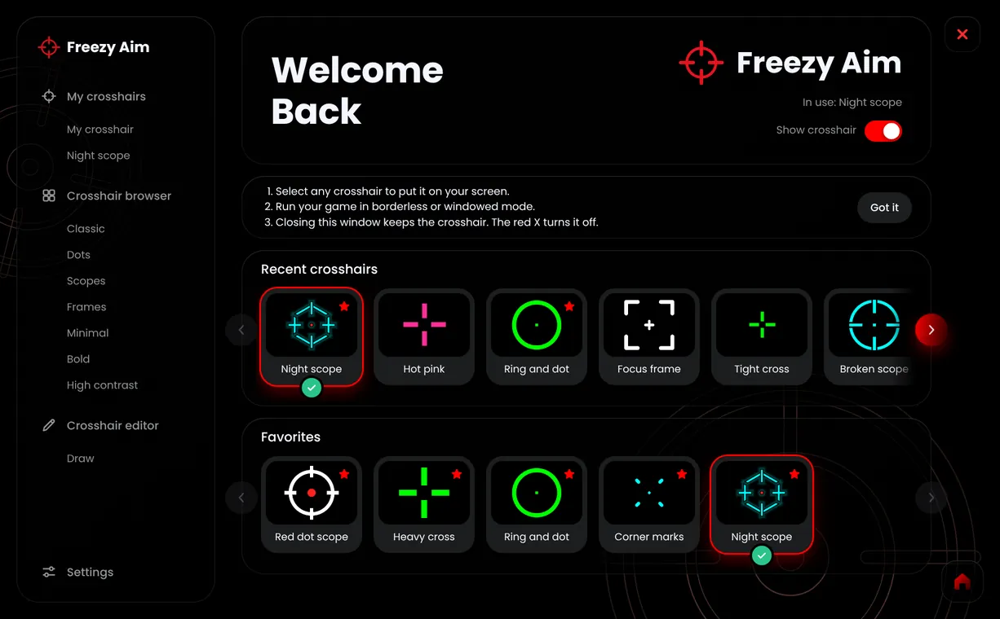

<p align="center">
  
</p>

<h1 align="center">Freezy Aim</h1>

<p align="center">A free, open-source crosshair overlay for games on Windows, macOS and Linux.</p>

<p align="center"><a href="../../releases/latest"><strong>Download Freezy Aim</strong></a></p>



## How it works

Freezy Aim draws a crosshair in a small see-through window on top of your game. It doesn't
read or change the game, and your clicks pass straight through it.

1. Open Freezy Aim and pick a crosshair, or make your own in the Crosshair Editor or Draw.
2. Select **Use crosshair**.
3. Start your game in **borderless** or **windowed** mode. Exclusive fullscreen can hide
   the crosshair.

The red X closes everything. Closing just the window keeps the crosshair on screen, and you
can reopen the app from its icon in your system tray or menu bar.

## Download

Get your version from the [latest release](../../releases/latest).

| System | File |
| --- | --- |
| Windows | `FreezyAim.exe` |
| macOS with Apple silicon (M1 or newer) | `freezy-aim-macos-apple-silicon` |
| macOS with Intel | `freezy-aim-macos-intel` |
| Linux | `freezy-aim-linux-x64` |
| Linux on ARM | `freezy-aim-linux-arm64` |

### Windows

Double-click `FreezyAim.exe`. There's nothing to install. If Windows shows a warning, select
**More info**, then **Run anyway**.

### macOS

1. Install [Python 3](https://www.python.org/downloads/).
2. Open Terminal and install what the crosshair needs:

   ```
   python3 -m pip install PySide6 pyobjc-framework-Cocoa
   ```

3. Go to your Downloads folder, then start the app, using the name of the file you downloaded:

   ```
   cd ~/Downloads
   chmod +x freezy-aim-macos-apple-silicon
   xattr -d com.apple.quarantine freezy-aim-macos-apple-silicon
   ./freezy-aim-macos-apple-silicon
   ```

### Linux

1. Install Python 3 if you don't have it, then install what the crosshair needs:

   ```
   python3 -m pip install PySide6
   ```

   If pip refuses with an "externally managed" error, run these instead, then do step 2
   in the same terminal:

   ```
   python3 -m venv ~/freezy-aim-python
   source ~/freezy-aim-python/bin/activate
   pip install PySide6
   ```

2. Go to your Downloads folder, then start the app:

   ```
   cd ~/Downloads
   chmod +x freezy-aim-linux-x64
   ./freezy-aim-linux-x64
   ```

The crosshair needs X11 or XWayland.

macOS and Linux are new and haven't been fully tested yet, and they don't have keyboard
shortcuts. If you try one, please [tell us how it went](../../issues/new/choose).

## Build from source

You need [Go](https://go.dev/dl/) 1.24 or newer. See [CONTRIBUTING.md](CONTRIBUTING.md).

```
cd src
go build -trimpath -tags nethttpomithttp2 -ldflags "-s -w" -o freezy-aim .
```

## License

[MIT](LICENSE). See [THIRD_PARTY_NOTICES.md](THIRD_PARTY_NOTICES.md) for included work.
